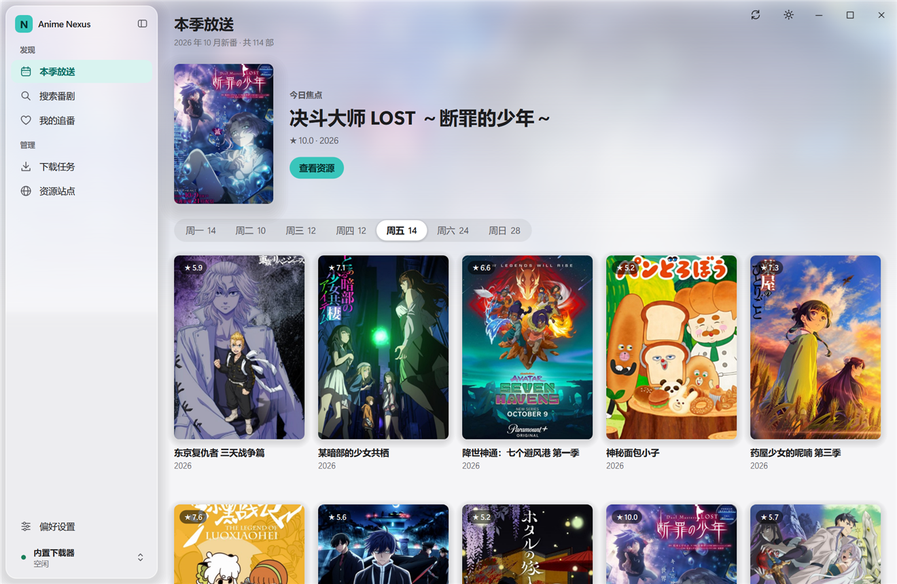

# Miku Library

按字幕组整理的番剧资源聚合搜索与下载工具 · Windows x64

[下载](../../releases/latest) · [使用指南](docs/usage.md) · [常见问题](docs/troubleshooting.md) · [更新记录](UI_REWRITE.md)

<picture>
  <source media="(prefers-color-scheme: dark)" srcset="docs/screenshot-home-dark.png">
  
</picture>

## 特点

- **找番**：按星期浏览 Bangumi 本季放送，支持中文、日文、英文番名搜索。
- **按字幕组整理**：同时检索 Nyaa、动漫花园、蜜柑计划等来源，按字幕组归并，标出清晰度、编码和字幕语言。
- **一键补集**：按字幕组补齐缺集，可选字幕、清晰度和集数范围，自动去重。
- **追更提醒**：检查你常用字幕组的新集，在右下角提示一键下载，也可以按番剧设为自动下载。
- **下载管理**：内置下载器开箱即用，也可交给 qBittorrent、Transmission、aria2 等；文件按「番剧 / 字幕组 / 季」自动归档。
- **后台运行**：关闭窗口后可在托盘继续下载，完成时系统通知。
- **浅色 / 深色**：跟随系统或手动切换；支持代理、离线放送表和一键备份。

## 开始使用

1. 在 [Releases](../../releases/latest) 下载 `MikuLibrary-Windows-x64-Portable-*.zip`，完整解压后运行 `MikuLibrary.exe`，无需安装。
2. 首次启动时选择下载位置（默认为 `下载\MikuLibrary`）和界面配色，阅读并同意使用声明。
3. 在「本季放送」或搜索（`Ctrl+K`）里找到番剧，选一个字幕组下载；完成后在「我的追番」点「播放」。

> 本软件不含播放器。番剧资源多为 HEVC / 10bit 编码并带 ASS 特效字幕，推荐使用 PotPlayer、mpv 或 MPC-HC。

## 文档

| | |
|---|---|
| [使用指南](docs/usage.md) | 搜索、筛选、下载、追更提醒、本地文件与数据位置 |
| [外部下载器](docs/downloaders.md) | 改用 qBittorrent、Transmission、aria2 等，以及本机连接管理 |
| [常见问题](docs/troubleshooting.md) | 下载停在 0%、无法播放、目录丢失等 |
| [开发](docs/development.md) | 从源码构建、测试与代码结构 |
| [使用声明](docs/disclaimer.md) | 完整的使用声明 |
| [1.0.0 更新说明](docs/changes-1.0.0.md) | 相比 0.7.0 的主要变化 |
| [更新记录](UI_REWRITE.md) | 每次改动的说明与验证 |

## 声明

Miku Library 免费开源，从不收费；如果你为它付过钱，请申请退款并举报卖家。

本软件只做检索与下载管理，不提供任何影视内容。下载的番剧仅供个人学习交流，请在 24 小时内删除，并支持正版。详见[使用声明](docs/disclaimer.md)。

## 许可证

Miku Library 以 [GNU GPL v3.0](LICENSE) 发布，Copyright © 2026 Magician0711。你可以自由使用、修改和再分发；分发修改后的版本时，须同样以 GPL-3.0 公开其源码。

第三方组件：mpv / libmpv（GPL）、Anime4K 着色器（MIT）、Qt 6.8.3（LGPLv3）、libtorrent 2.1.2（BSD-3-Clause）、OpenSSL 3（Apache-2.0）、Boost（BSL-1.0），许可文本见 [licenses](licenses)。
