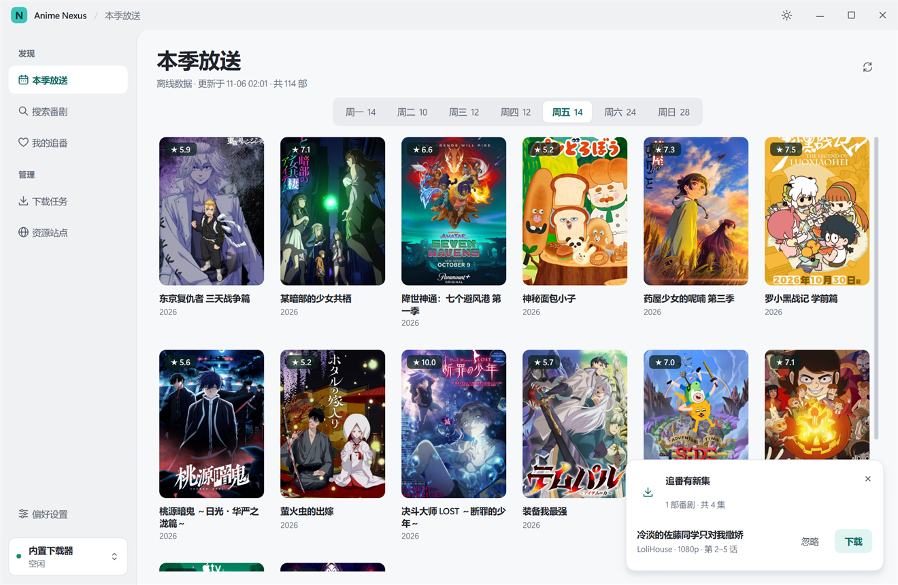

# 使用指南

[← 返回 README](../README.md)

## 找番

- **本季放送**：按星期列出 Bangumi 本季新番，默认打开今天。页面顶部的「今日焦点」是所选这一天评分最高的作品。暂时连不上 Bangumi 时，显示上次成功加载的放送表，并在标题旁注明「离线数据 · 更新于…」。
- **搜索番剧**：`Ctrl+K` 随时打开，输入前先显示本季评分最高的番剧，中文、日文、英文番名和别名都可以。结果默认按「最新」排列（播出年份从新到旧，同一年评分高的在前），也可以切换为「评分」或「相关度」。
- **我的追番**：收藏的作品，以及已有本地视频的作品。可切换「全部 / 追番 / 已下载」。

## 窗口与布局

- 窗口变窄时，侧栏自动收成图标栏；也可以点侧栏右上角的按钮或按 `Ctrl+\` 手动收起。
- 点「播放」后，视频在内置播放器中打开。侧栏的「正在播放」可以随时回到画面，离开这一页时声音继续。空格暂停，左右键快退快进 5 秒，上下键调音量，`F` 全屏，`M` 静音，`Esc` 退出全屏；单击画面暂停，双击全屏。下次打开同一个视频会从上次的位置继续。
- 控制条的「超分」可以开启 Anime4K 实时超分：「流畅」适合大多数显卡，「高画质」需要较强的显卡，卡顿时调低或关闭。第一次开启时要准备一两秒。
- 程序已在运行（包括最小化到托盘）时再次打开，不会启动第二个，而是回到现有窗口，并检查一次软件更新、追番新集和放送表。一分钟内重复打开只检查一次。
- 打开番剧详情时侧栏自动收起，返回后恢复。详情页左上角的返回按钮写着要回到的页面，比如「‹ 本季放送」，也可以按 Esc。
- 侧栏收起时，把鼠标停在上面会临时展开并把右侧内容推开，不会遮住内容，移开后收回；点展开后的按钮可以固定。
- 海报列数和大小跟随窗口宽度，始终铺满内容区；番剧详情在宽窗口里分成左右两栏。
- `Ctrl+,` 打开偏好设置。窗口足够宽时，所有分区同时显示；窄一些时用顶部的分段按钮切换。
- Windows 的「透明效果」关闭时，侧栏改用不透明底色。

## 选资源

番剧详情会同时检索所有已启用的资源站（Nyaa、动漫花园、蜜柑计划、ACG.RIP、Tokyo Toshokan、Anime Garden、Bangumi.Moe、SubsPlease），并按字幕组归并：

- 字幕组默认按「推荐」排序（做种人气与资源数综合），识别不出字幕组的资源合并为「未归档资源」放在最后。
- 每条资源标出清晰度、编码、位深、HDR / 杜比视界、音频和字幕标签。
- 同一部番有其他季度、篇目或剧场版时，筛选栏最前面会出现季度与篇目选择。切换后海报、简介和资源都换成所选的那一部。这个列表按番剧主名在 Bangumi 上搜索，名称沿用 Bangumi 的写法，比如「游郭篇」「第二季」「剧场版 无限列车篇」。
- 可按资源类型、画质、字幕、关键词，以及「全部 / 已下载 / 未下载」筛选。找不到其他条目时，这个位置显示「全部季度」，按资源标题里的季度筛选。

## 下载

- **单集**：点资源右侧的「下载」。
- **一键下载**：字幕组右侧的按钮用来补齐当前结果里缺少的正片；已有下载时显示为「更新」。检索期间按钮上会转动加载图标，完成后才能点。点击后弹窗询问下载方式：可选字幕语言与形式、清晰度和起止集数，并实时显示将新建的任务，确认后才开始下载。
- **去重**：按番剧、字幕组、季度和集数检查，同一集只下载一个画质版本；合集与已有集数重叠时只下载能明确识别的缺集。无法确认集数的资源不会被猜测，会提示原因。
- **保存位置**：`下载目录 / 番剧名 / 字幕组 / 第 N 季 /`。下载目录在首次启动时选择，默认是系统「下载」文件夹下的 `MikuLibrary`，之后可在「偏好设置 → 下载」修改。修改后会询问是否把已下载的番剧一起移过去：内置下载器的任务（包括下载到一半的）会在新位置继续，外部下载器的任务需要在对应软件里自行移动。
- 每部番剧会记住上次选的字幕组、清晰度和字幕类型，下次一键下载时自动预填。

## 追更提醒

每次启动约 10 秒后，在后台检查一次你下载过的番剧；也可以随时在「我的追番」或托盘菜单点「检查追更」：没有新集时在窗口中央短暂提示，有新集时会询问是否按上次的字幕组和清晰度全部下载。程序一直开着的话，可在「偏好设置 → 通用 → 追更与通知」设为每 3 / 6 / 12 小时再查一次。

- 只看你上次下载所用的字幕组，按同样的清晰度和字幕类型，查找已下载最新一集之后的新集。
- 看完删掉的集数仍算已追到；失败或取消的任务不算。已下载完整的番剧不再检查。
- 有新集时，右下角出现提示：「下载」补齐这些集，「忽略」不再提示这些集（之后有更新的集仍会提醒），多部时可「全部下载」。
- 每部番剧可以在详情页的「追更」按钮里选择：不追更、有新集时提醒、有新集时自动下载。选了自动下载的番剧不再弹提示，直接按上次的字幕组和清晰度下载，并发送一条系统通知。

## 下载任务

- 支持暂停、恢复、移除。每个任务前有勾选框，可逐个勾选多个任务批量操作；点表头「全选」选中全部，也可以按住 `Ctrl` / `Shift` 多选。
- 移除内置任务时会询问是否同时删除文件；勾选「记住我的选择」后不再询问，可在「偏好设置 → 下载 → 任务」改回。
- 「同时删除文件」会删除视频、种子文件，以及因此留空的番剧、字幕组和季度文件夹；文件夹里还有其他文件时会保留，下载目录本身不会被删除。「仅移除任务」不动磁盘上的任何文件。
- 下载完成后默认继续上传（做种），让其他人也能下载。「偏好设置 → 下载」中的「下载完成后自动停止」默认关闭，开启前需要再次确认；开启后完成的任务停止下载和上传，保留在列表中。之后再关闭时，被它停止的任务会恢复做种。
- 默认全局上传上限为 1 MiB/s，其余速率和数量不限；设置里填 0 表示不限。
- 内置任务 90 秒收不到数据时，会自动尝试其他来源（可调整或关闭）。
- 「下载任务」页右上角的下载器按钮可切换后续任务使用的下载器，见[外部下载器](downloaders.md)。
- 开始下载前会检查下载目录所在磁盘的剩余空间；资源站给出的大小明显放不下时，会提示并不创建任务。

## 后台运行与通知

- 关闭窗口时会询问「最小化到托盘」还是「退出软件」；勾选「记住我的选择」后不再询问，可在「偏好设置 → 通用 → 窗口」随时改回「每次询问」。
- 最小化到托盘后，下载和追更检查在后台继续。单击托盘图标打开窗口，右键菜单可以「检查追更」或「退出」。
- 下载完成时会显示系统通知（同一批完成的合并为一条），点击打开「我的追番」；可在「窗口与提示」中关闭。

## 播放

下载完成的视频出现在「我的追番」，点「播放」用系统默认播放器打开；合集可以选择具体文件。本软件不含播放器，建议安装 PotPlayer、mpv 或 MPC-HC，并设为 `.mkv` / `.mp4` 的默认打开方式。

只有下载完成、文件确实存在且大小一致的视频才会显示为可播放；删除或移动视频后，它会从列表中消失。

## 资源站点

「偏好设置 → 资源与网络 → 资源站点」里点「管理站点」，可启用或停用来源、测试连接，以及导入、导出站点列表。列表按「已启用的搜索源 → 未启用的搜索源 → 网页目录」排列，并显示网址、类别（公开 / 需账号 / 社区）、语言和搜索方式（RSS / JSON 接口）。默认列表有 90 个条目，其中 8 个具备搜索适配器，其余是网页目录或需要登录的站点。自定义条目填写有效的 `rss_url`（关键词处写 `{q}`）即可参与搜索。

## 数据位置

用户数据在 `%USERPROFILE%\.miku-library\`：

| 文件 | 内容 |
|---|---|
| `config.json` | 下载目录、配色、下载器与连接设置 |
| `anime_sites.json` | 资源站列表和启用状态 |
| `local-library.json` | 下载记录（番剧、字幕组、季度、集数、文件），以及每部番剧的下载偏好 |
| `miku_library.db` | 收藏与 Bangumi 信息缓存 |
| `covers/400x600/` | 海报缓存，可在「偏好设置 → 数据」清理 |
| `engine/state.json` | 内置下载器的任务状态 |

种子文件保存在视频旁边，是隐藏文件（`torrent-` 开头），内置下载器靠它在重启后恢复任务和继续做种，请不要删除。需要查看时，在资源管理器中打开「显示隐藏的项目」。

## 网络代理

如果资源站或 Bangumi 需要代理才能访问，在「偏好设置 → 资源与网络 → 代理」选择：

- **跟随系统代理**（默认）：使用 Windows 的代理设置，大多数代理软件开启「系统代理」后即可生效；
- **不使用代理**；
- **HTTP 代理 / SOCKS5 代理**：填写地址和端口，例如本机代理软件的 `127.0.0.1 : 7890`。
- **监听端口**：内置下载器接受其他用户连接的端口。这个端口被其他程序占用或被 Windows 保留时，程序会自动改用其他可用的端口，下次启动再试一次原来的端口。

代理用于检索、海报、放送表和新版本检查；连接本机下载器（qBittorrent、aria2 等）始终直连。内置下载器的节点传输不经过这里的代理。

## 备份与恢复

「偏好设置 → 数据 → 备份与恢复」可以把设置、资源站点、下载记录（包括每部番剧的字幕组选择）和追番列表导出成一个 `.json` 文件。在新电脑或重装后「导入备份」，软件会关闭并自动重新打开。备份不包含视频文件；如果新电脑的下载目录不同，启动时会提示重新选择。

## 检查新版本

「偏好设置 → 关于」中可以立即检查是否有新版本，或关闭「启动时检查」。检查只读取 GitHub 上最新发布的版本号，不会自动下载或安装；有新版本时，标题栏右侧会出现「新版本」按钮，点击打开下载页面。

## 命令行

- `--add-magnet <磁力链接>` / `--add-torrent <种子文件>`：按当前下载器和目录导入，可搭配 `--subject <Bangumi ID>` 指定番剧；无法唯一匹配时会先让你选择。
- 同一数据目录只运行一个实例，再次打开会切换到已有窗口并转交参数。
